<!-- Shinobi of Code: profile README for github.com/rajbchoudhary79 -->

  

  

  
  
  

  

  

  
  

  

## 🥷 S-Rank Missions

| Rank | Mission | What it is | Jutsu used | Links |
|:---:|---|---|---|---|
| 🟥 **S** | **Personal Portfolio** | Animated one-page portfolio with scroll effects | HTML5 · CSS3 · JavaScript | [🌐 Live](https://rajbchoudhary79.github.io) · [📜 Code](https://github.com/rajbchoudhary79/rajbchoudhary79.github.io) |
| 🟧 **A** | **React Static Project** | Static site built with React components | React · JavaScript | [📜 Code](https://github.com/rajbchoudhary79/react-static) |
<!--
| 🟥 **S** | **Your App Name** | One line on what it does and who it helps | React Native · Laravel API | [🌐 Demo](link) · [📜 Code](link) |
-->

  

  

  
  
  <!--  -->

